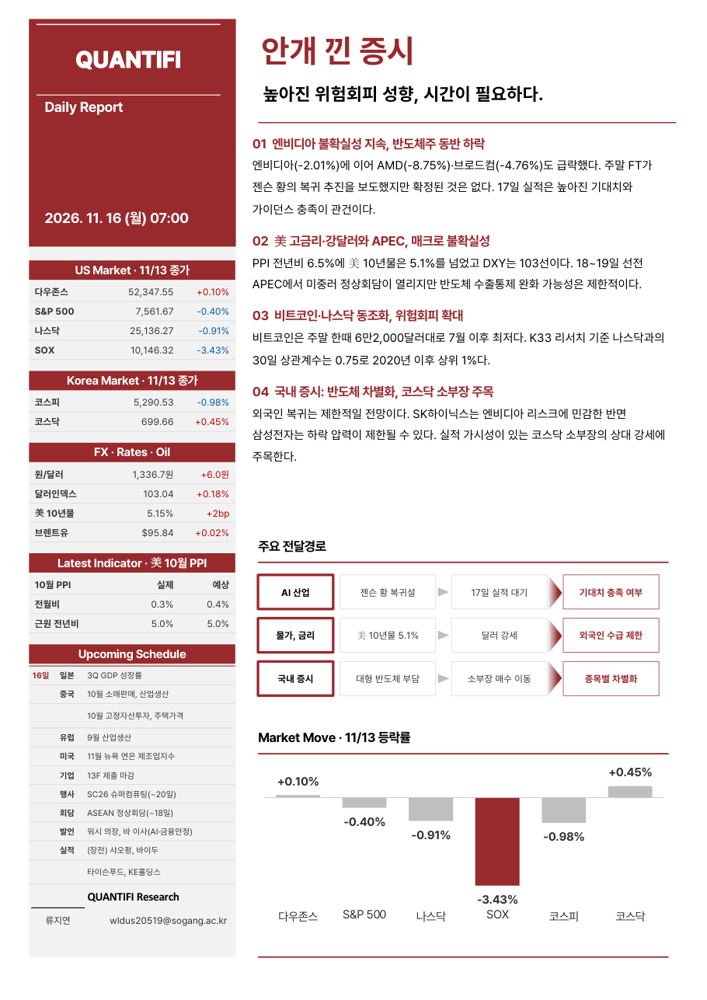
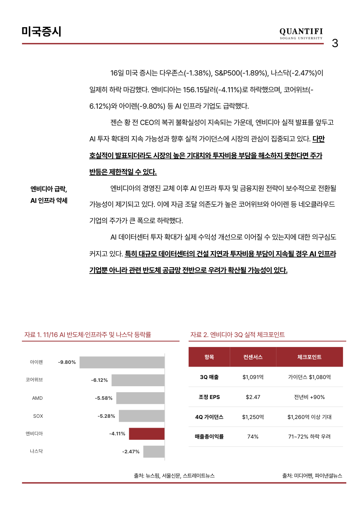
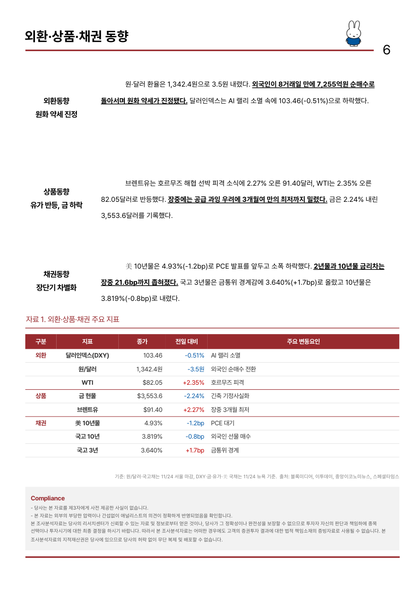
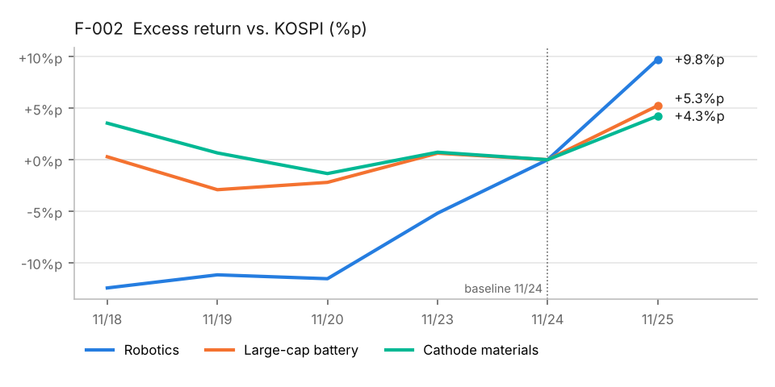
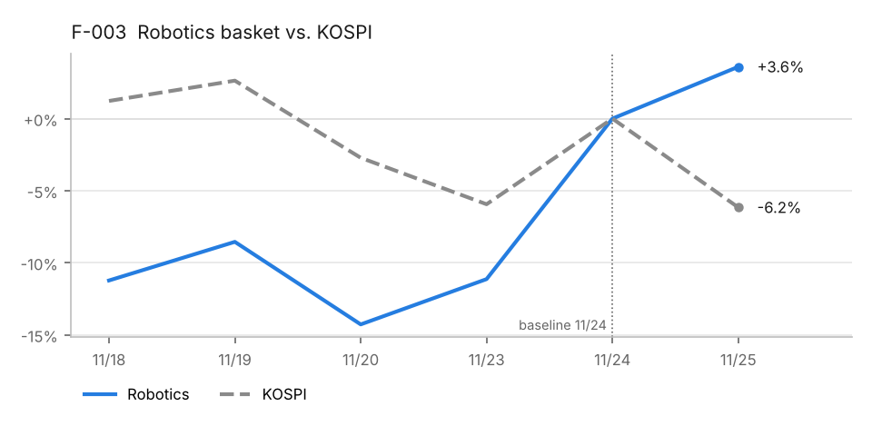

# MIFFY 7시 리포트

> 매일 아침 07:00 (일요일 제외) · 06:00 미국장 마감 이후 이슈 반영

**English** — A daily Korean-language market brief from QUANTIFI (Sogang University quant society), published at 07:00 KST Monday–Saturday after the U.S. close. It covers U.S. equities, macro, the Korean equity outlook and FX/commodities/bonds. Index forecasts from society discussions are added before key data releases, and quant notes appear occasionally.

**페이지 구성**

| 페이지 | 내용 |
|---|---|
| p.1 | 요약 — 핵심 이슈, 미국·한국 주요 지수, FX·금리·유가, 주요 일정 |
| p.2 | 목차 |
| p.3 | 미국증시 (US Market) |
| p.4 | 매크로 (Macro) |
| p.5 | 한국증시 — 오늘의 전망 및 전일 장 마감 (Korea Market) |
| p.6 | 외환·상품·채권 동향 (FX · Commodity · Bond) |

**+α** : 주요 지표 발표 전날 학회원 토론 기반 지수 예측치 · 퀀트 분석(비정기)

## 🆕 최신 리포트

### [하루짜리 복귀효과는 숏스퀴즈?](reports/2026-11-25_daily.pdf)
*숏스퀴즈, 데드캣바운스, 차익실현, 귀걸이, 코걸이*  
2026-11-25 (수) · 📰 Daily

     

## 📌 전망 추적

리포트에서 검증 가능한 전망을 골라 **판정 기준을 미리 정해** 등록하고, 이후 실제 주가로 추적합니다. 동일가중 바스켓 기준이며 배당·비용은 반영하지 않습니다.

| ID | 전망 | 기준일 | 판정 | 현재 | 상태 |
|---|---|---|---|---|---|
| [F-001](theses/F-001.md) | 반도체 연말 혼조세 유지 | 11/24 | 2026-12-30 | 바스켓 -6.9% (허용 ±10%) | ⏳ 진행 중 · 범위 안 |
| [F-002](theses/F-002.md) | 로봇 → 대형 배터리 → 양극재 순환매 | 11/24 | D+20 / D+40 | 로봇 +9.8%p · 대형 배터리 +5.3%p · 양극재 +4.3%p | ⏳ 진행 중 (D+1) |
| [F-003](theses/F-003.md) | 로봇주 시장 대비 강세 지속 | 11/24 | D+10 / 2027-01-08 | 초과수익 +9.8%p | ⏳ 진행 중 |

  

마지막 갱신: 2026-11-25 종가 · 데이터: KRX 일별 종가

## 📚 리포트 목록

| 날짜 | 구분 | 제목 |
|---|---|---|
| 2026-11-25 (수) | 📰 Daily | [하루짜리 복귀효과는 숏스퀴즈?](reports/2026-11-25_daily.pdf) |
| 2026-11-24 (화) | 📰 Daily | [강력한 신뢰회복 이벤트](reports/2026-11-24_daily.pdf) |
| 2026-11-23 (월) | 📰 Daily | [바닥은 도대체 어디에](reports/2026-11-23_daily.pdf) |
| 2026-11-20 (금) | 📰 Daily | [앤트로픽이 불러올 파장, P or N](reports/2026-11-20_daily.pdf) |
| 2026-11-19 (목) | 📰 Daily | [진짜로 빅스텝?](reports/2026-11-19_daily.pdf) |
| 2026-11-18 (수) | 📰 Daily | [루빈효과 vs 오너 리스크](reports/2026-11-18_daily.pdf) |
| 2026-11-17 (화) | 📰 Daily | [엔비디아발 AI 투매](reports/2026-11-17_daily.pdf) |
| 2026-11-16 (월) | 📰 Daily | [안개 낀 증시](reports/2026-11-16_daily.pdf) |
| 2026-11-14 (토) | 📰 Daily | [코스닥 다시 부활하나](reports/2026-11-14_daily.pdf) |
| 2026-11-13 (금) | 📰 Daily | [젠슨 황 시대 끝났다.](reports/2026-11-13_daily.pdf) |
| 2026-11-12 (목) | 📰 Daily | [반도체 반등할까?](reports/2026-11-12_daily.pdf) |
