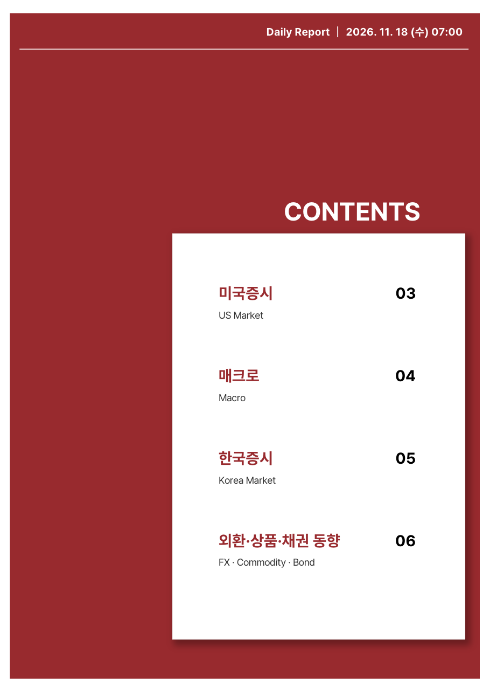
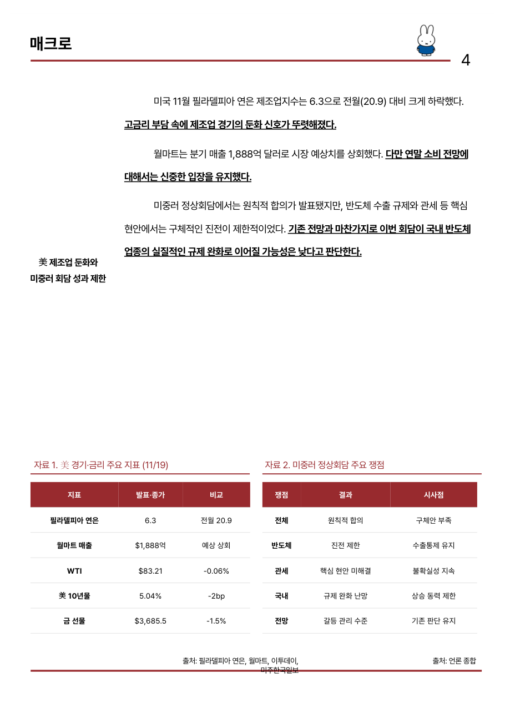
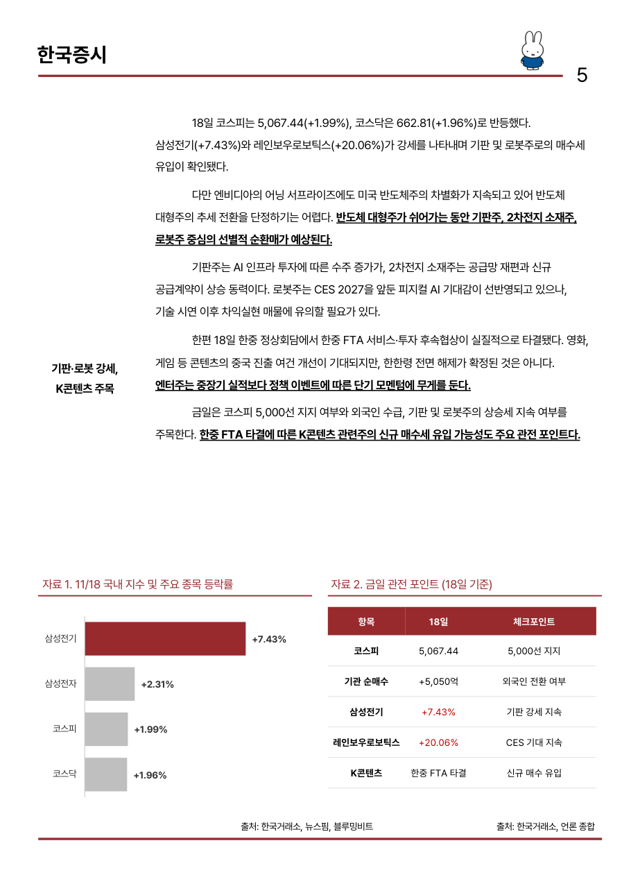

# QUANTIFI 7시 리포트

> 매일 아침 07:00 (일요일 제외) · 06:00 미국장 마감 이후 이슈 반영

**English** — A daily Korean-language market brief from QUANTIFI (Sogang University quant society), published at 07:00 KST Monday–Saturday after the U.S. close. It covers U.S. equities, macro, the Korean equity outlook and FX/commodities/bonds. Index forecasts from society discussions are added before key data releases, and quant notes appear occasionally.

**페이지 구성**

| 페이지 | 내용 |
|---|---|
| p.1 | 요약 — 핵심 이슈, 미국·한국 주요 지수, FX·금리·유가, 주요 일정 |
| p.2 | 목차 |
| p.3 | 미국증시 (US Market) |
| p.4 | 매크로 (Macro) |
| p.5 | 한국증시 — 오늘의 전망 및 전일 장 마감 (Korea Market) |
| p.6 | 외환·상품·채권 동향 (FX · Commodity · Bond) |

**+α** : 주요 지표 발표 전날 학회원 토론 기반 지수 예측치 · 퀀트 분석(비정기)

## 🆕 최신 리포트

### [엔비디아발 AI 투매](reports/2026-11-17_daily.pdf)
*실적 앞둔 경계감, 로봇·소부장으로 시선 이동*  
2026-11-17 (화) · 📰 Daily

     

## 📚 리포트 목록

| 날짜 | 구분 | 제목 |
|---|---|---|
| 2026-11-17 (화) | 📰 Daily | [엔비디아발 AI 투매](reports/2026-11-17_daily.pdf) |
| 2026-11-16 (월) | 📰 Daily | [안개 낀 증시](reports/2026-11-16_daily.pdf) |
| 2026-11-14 (토) | 📰 Daily | [코스닥 다시 부활하나](reports/2026-11-14_daily.pdf) |
| 2026-11-13 (금) | 📰 Daily | [젠슨 황 시대 끝났다.](reports/2026-11-13_daily.pdf) |
| 2026-11-12 (목) | 📰 Daily | [반도체 반등할까?](reports/2026-11-12_daily.pdf) |
