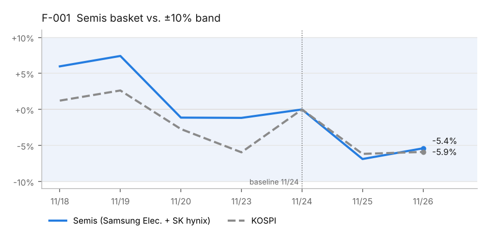

# F-001 반도체 연말 혼조세 유지

- **등록일:** 2026-11-25 · **출처:** [2026-11-25_daily.pdf](../reports/2026-11-25_daily.pdf)
- **기준일:** 2026-11-24 종가 (리포트 발행 07:00, 장 시작 전 작성)
- **벤치마크:** KOSPI

## 전망

> 젠슨 황 복귀 효과가 하루 만에 약화된 만큼 반도체주의 추세 전환을 판단하기 어렵다. 연말까지 혼조세가 이어질 것이다.

## 판정 기준 (사전 확정)

12/30 종가 기준, 삼성전자·SK하이닉스 동일가중 바스켓 수익률이 기준일 대비 ±10% 이내면 적중

## 관찰 대상

| 그룹 | 종목 |
|---|---|
| Semis (Samsung Elec. + SK hynix) | 삼성전자 (005930), SK하이닉스 (000660) |

## 현재 상태

⏳ 진행 중 · 범위 안 — 바스켓 -5.4% (허용 ±10%) (기준: 2026-11-26 종가)

*동일가중 바스켓, 배당·비용 미반영. 데이터: KRX 일별 종가.*
