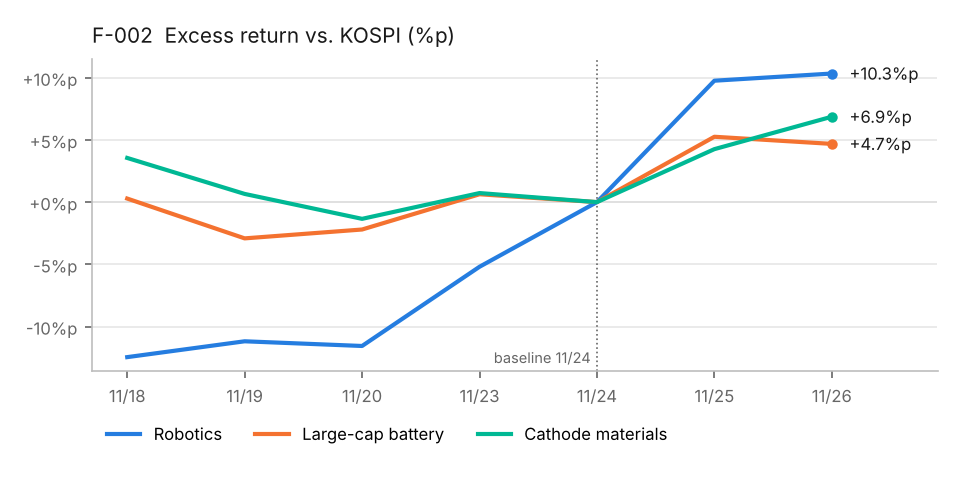

# F-002 로봇 → 대형 배터리 → 양극재 순환매

- **등록일:** 2026-11-25 · **출처:** [2026-11-25_daily.pdf](../reports/2026-11-25_daily.pdf)
- **기준일:** 2026-11-24 종가 (리포트 발행 07:00, 장 시작 전 작성)
- **벤치마크:** KOSPI

## 전망

> 휴머노이드 양산이 구체화되면 투자자금이 로봇 부품주에서 2차전지로 확산된다. 초기에는 대형 배터리주 중심으로 기대가 반영되고, 이후 소재·부품 중소형주로 순환매가 확산될 수 있다.

## 판정 기준 (사전 확정)

① D+20 종가 기준 대형 배터리 바스켓의 KOSPI 대비 누적 초과수익 > 0 ② D+40까지 양극재 바스켓의 초과수익 고점이 대형 배터리보다 늦게 나타나면 적중 (둘 다 충족)

## 관찰 대상

| 그룹 | 종목 |
|---|---|
| Robotics | 로보티즈 (108490), 레인보우로보틱스 (277810), 에스피지 (058610) |
| Large-cap battery | 삼성SDI (006400), LG에너지솔루션 (373220) |
| Cathode materials | 에코프로비엠 (247540), 엘앤에프 (066970), 대주전자재료 (078600) |

## 현재 상태

⏳ 진행 중 (D+2) — 로봇 +10.3%p · 대형 배터리 +4.7%p · 양극재 +6.9%p (기준: 2026-11-26 종가)

*동일가중 바스켓, 배당·비용 미반영. 데이터: KRX 일별 종가.*
