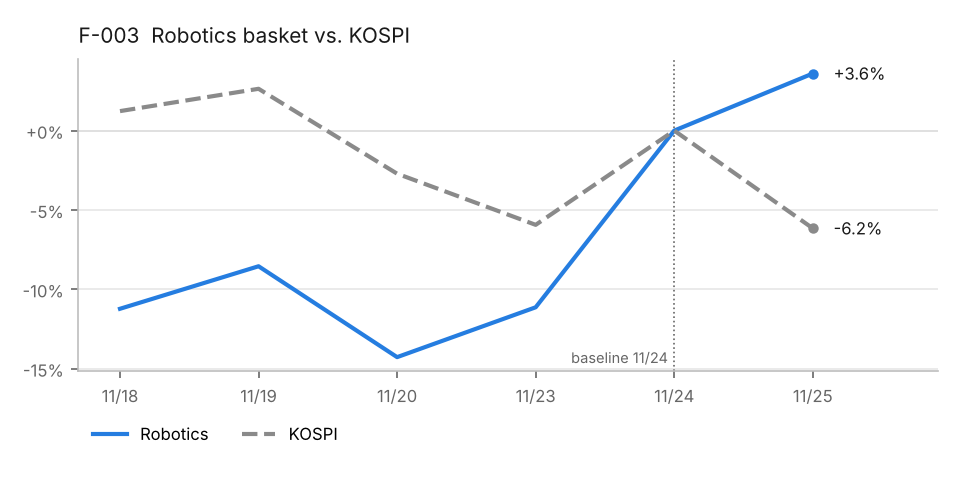

# F-003 로봇주 시장 대비 강세 지속

- **등록일:** 2026-11-25 · **출처:** [2026-11-25_daily.pdf](../reports/2026-11-25_daily.pdf)
- **기준일:** 2026-11-24 종가 (리포트 발행 07:00, 장 시작 전 작성)
- **벤치마크:** KOSPI

## 전망

> 샤오펑 AI Day, 휴머노이드 서밋, CES 2027(1/6~9) 등 이벤트가 이어지며 로봇주는 시장 대비 강세를 보일 것이다.

## 판정 기준 (사전 확정)

D+10(중간)과 2027-01-08(최종, CES 2027 마지막 국내 거래일) 종가 기준 로봇 바스켓의 KOSPI 대비 누적 초과수익 > 0이면 적중

## 관찰 대상

| 그룹 | 종목 |
|---|---|
| Robotics | 로보티즈 (108490), 레인보우로보틱스 (277810), 에스피지 (058610) |

## 현재 상태

⏳ 진행 중 — 초과수익 +9.8%p (기준: 2026-11-25 종가)

*동일가중 바스켓, 배당·비용 미반영. 데이터: KRX 일별 종가.*
