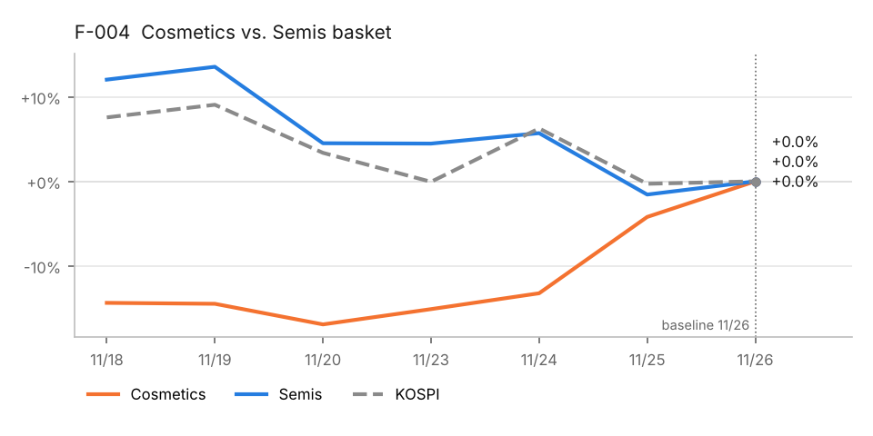

# F-004 연말까지 화장품 > 반도체

- **등록일:** 2026-11-26 · **출처:** [2026-11-26_daily.pdf](../reports/2026-11-26_daily.pdf)
- **기준일:** 2026-11-26 종가 (리포트에 11/26 오전 금통위 결과가 반영되어 있어 당일 종가 기준)
- **벤치마크:** KOSPI

## 전망

> 메모리 슈퍼사이클 정점론으로 연말까지 반도체 혼조세와 추가 하방 위험을 전망하며, 화장품 업종이 반도체보다 양호한 수익률을 기록할 것으로 판단한다.

## 판정 기준 (사전 확정)

12/30 종가 기준, 화장품 바스켓(코스맥스·에이피알·아모레퍼시픽) 수익률이 반도체 바스켓(삼성전자·SK하이닉스) 수익률보다 높으면 적중

## 관찰 대상

| 그룹 | 종목 |
|---|---|
| Cosmetics | 코스맥스 (192820), 에이피알 (278470), 아모레퍼시픽 (090430) |
| Semis | 삼성전자 (005930), SK하이닉스 (000660) |

## 현재 상태

⏳ 진행 중 — 화장품 +0.0% · 반도체 +0.0% (차 +0.0%p) (기준: 2026-11-26 종가)

*동일가중 바스켓, 배당·비용 미반영. 데이터: KRX 일별 종가.*
