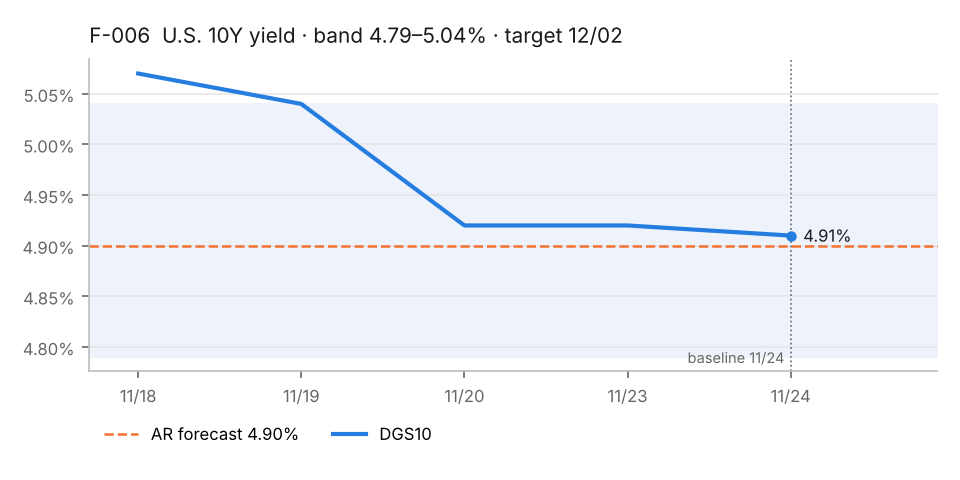

# F-006 美 10년물 1주 보합 (4.79~5.04%)

- **등록일:** 2026-11-27 · **출처:** [2026-11-27_quant.pdf](../reports/2026-11-27_quant.pdf)
- **기준일:** 2026-11-24 (모형 기준 시점은 11/24 종가, 공개는 11/27. 공개 전 11/25 값이 이미 관측됨)
- **벤치마크:** -

## 전망

> FRED DGS10의 11/24 종가 4.91%를 기준으로, 금리 AR 모형은 다음 5거래일 변화를 -0.8bp(4.90%)로 전망한다. 10·90분위수 범위는 4.79~5.04%다.

## 판정 기준 (사전 확정)

11/24 이후 5번째 미국 거래일(11/26 추수감사절 휴장 제외)인 12/2의 DGS10이 4.79~5.04% 안이면 적중. 점 전망 4.90% 대비 오차(bp)도 기록

## 관찰 대상

美 10년물 (FRED DGS10)

## 현재 상태

⏳ 진행 중 · 범위 안 — 4.91% (11/24) · 범위 4.79~5.04%

*데이터: FRED DGS10 (미 연준 H.15). FRED 게시 지연으로 최근 1~2일이 빠질 수 있음.*
